<p align="center">
  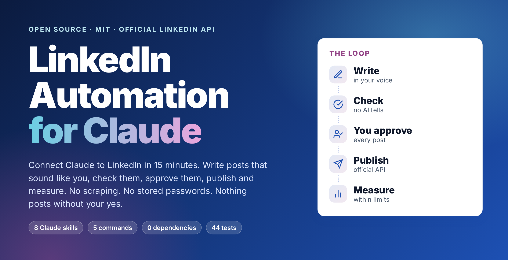
</p>

<h1 align="center">LinkedIn Automation for Claude</h1>

<p align="center">
  <b>Connect Claude to LinkedIn in 15 minutes.</b><br>
  Write posts that sound like you, check them, approve them, publish and measure - with the <b>official LinkedIn API</b>.<br>
  No scraping. No stored passwords. Nothing posts without your yes.
</p>

<p align="center">
  <a href="LICENSE"></a>
  
  
  
  
  <a href="https://github.com/phoenixDatasolutions/Linkedin-Automation/actions/workflows/ci.yml"></a>
  
  <a href="https://github.com/phoenixDatasolutions/Linkedin-Automation/stargazers"></a>
</p>

<p align="center">
  <a href="#quick-start-about-15-minutes">Quick start</a> ·
  <a href="#how-to-get-your-linkedin-api-key">Get your API key</a> ·
  <a href="#what-you-get">Skills</a> ·
  <a href="#see-it-work">Demo</a> ·
  <a href="#safe-by-default">Safety</a> ·
  <a href="docs/SETUP.md">Full setup guide</a> ·
  <a href="docs/FAQ.md">FAQ</a> ·
  <a href="ROADMAP.md">Roadmap</a>
</p>

<p align="center">
  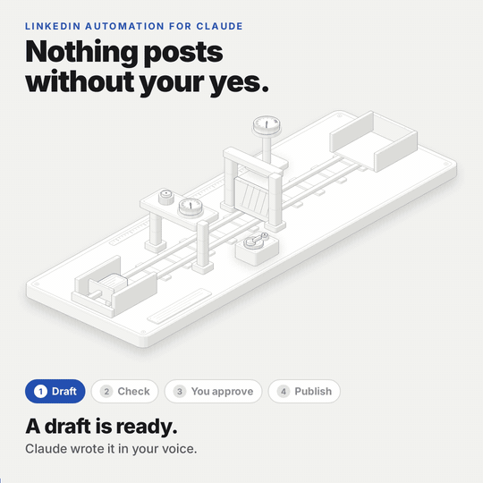<br>
  <sub><b>Nothing posts without your yes.</b> 24 seconds: draft, check, your approval, publish. <a href="docs/media/posting-line.mp4">Watch the MP4</a>.</sub>
</p>

---

## Why this exists

Most "LinkedIn automation" is a risk: browser bots, cookie hacks, scraped data, and accounts that get restricted. LinkedIn also publishes a real, free API, but its documentation is spread over about 600 pages and the setup (apps, products, scopes, OAuth, versions, rate limits) trips almost everyone.

This project gives Claude **everything needed to use that official API properly**:

- a **step-by-step wizard** that takes you from nothing to your first post (and tells you what an "API key" actually is on LinkedIn),
- **writing skills** that make posts sound like *you*, with a built-in AI-tell checker,
- **safe publishing**: dry run by default, a human approval step on every post, a daily call budget, a scheduler that never posts unapproved text,
- **analytics** that respect LinkedIn's 100-calls-a-day limit,
- and **the whole LinkedIn API in 10 guides** that Claude can answer from (auth, posting, analytics, limits, rules, errors, versions).

<p align="center">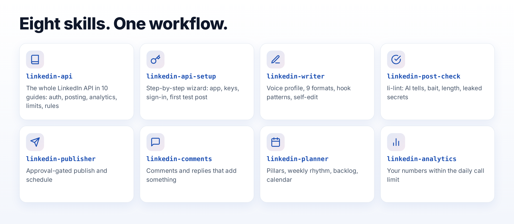</p>

## Quick start (about 15 minutes)

**1. Add the skills to Claude**

```text
/plugin marketplace add phoenixDatasolutions/Linkedin-Automation
/plugin install linkedin-automation --marketplace phoenixDatasolutions/Linkedin-Automation
```

Prefer to do it by hand? Copy the folders from [`skills/`](skills) into `~/.claude/skills/` (see [other ways to install](#other-ways-to-install)).

**2. Install the five small commands** (Python 3.9+, no other packages)

```bash
pipx install git+https://github.com/phoenixDatasolutions/Linkedin-Automation
li-auth check
```

**3. Tell Claude what you want**

> *"Set up LinkedIn automation for me."*

Claude walks you through the rest, one step at a time (the `linkedin-api-setup` skill). You will:

1. create a free LinkedIn developer app,
2. add two instant products (no review needed),
3. type your **client ID and secret into your own terminal** (never into chat),
4. sign in once with LinkedIn's OAuth screen,
5. do a dry run, then your first post.

<p align="center">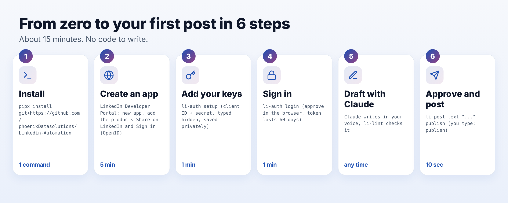</p>

## How to get your LinkedIn "API key"

There is no single API key on LinkedIn. You create an **app** (you get a *client ID* and a *client secret*), then each person signs in with OAuth 2.0 and the app receives an **access token** that lasts 60 days. What you can do depends on which **products** you add to the app:

<p align="center">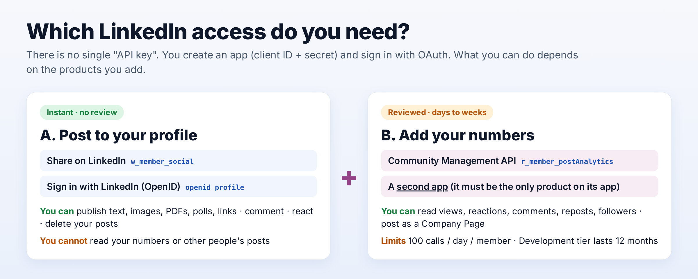</p>

| You want | Add this product | Review? |
|---|---|---|
| Post to your own profile | **Share on LinkedIn** + **Sign in with LinkedIn using OpenID Connect** | No - instant |
| Read your own views, comments, reposts | **Community Management API** on a *second* app | Yes - days to weeks |
| Post as a Company Page | Community Management API, and you must be a Page admin | Yes |

The full click-by-click guide, with the exact screens and the errors people hit, is in [`docs/SETUP.md`](docs/SETUP.md).

## What you get

| Skill | What it does |
|---|---|
| **`linkedin-api-setup`** | Guided wizard: Page, app, products, keys, sign-in, first test post. Never asks you to paste a secret into chat. |
| **`linkedin-writer`** | Builds a voice profile from your own writing, then drafts in 9 proven formats with hook patterns and a self-edit checklist. |
| **`linkedin-post-check`** | `li-lint`: opening line, length, AI tells, engagement bait, hashtags, links, emoji, leaked secrets. |
| **`linkedin-publisher`** | Publish text, images, PDF carousels, polls and links, with a first comment. Dry run first, explicit approval always. Schedule with a human-approved queue. |
| **`linkedin-comments`** | Comments and replies that add something, in your voice, for you to post by hand. |
| **`linkedin-planner`** | Pillars, weekly rhythm, a backlog built from your real work, a monthly calendar. |
| **`linkedin-analytics`** | Your numbers within the 100-calls-a-day limit, and how to read them. |
| **`linkedin-api`** | The whole LinkedIn API, written up for Claude to answer from: auth, posting, analytics, limits, rules, errors, versions. |

The five commands behind them: `li-auth`, `li-post`, `li-lint`, `li-stats`, `li-schedule` (plus `li-secrets-scan`).

## See it work

> The conversation below is an illustration of the flow, not a recording.

```text
You     Write a LinkedIn post about how we cut our month-end close from 3 days to 1 afternoon.
Claude  (reads your VOICE.md) Quick questions so it is true and specific: what changed first,
        and what number are you comfortable sharing?
You     We moved everything to one data model. Close went from ~3 days to about 5 hours.
Claude  Five first lines:
          1. Our month-end close used to take three days. Now it takes one afternoon.
          2. The boring change that gave my finance team two days back every month.
          ...
        Draft (612 characters) ... li-lint: score 94, 0 errors, 1 note.
        Approve this exact text, visibility Public, first comment with the link?
You     Approve.
Claude  $ li-post text --file post.txt --first-comment "..." --publish --yes
        Published: https://www.linkedin.com/feed/update/urn:li:share:...
        Calls made today: 2 of 100.
```

### The real output

These are screenshots of the actual commands, not mock-ups.

<p align="center">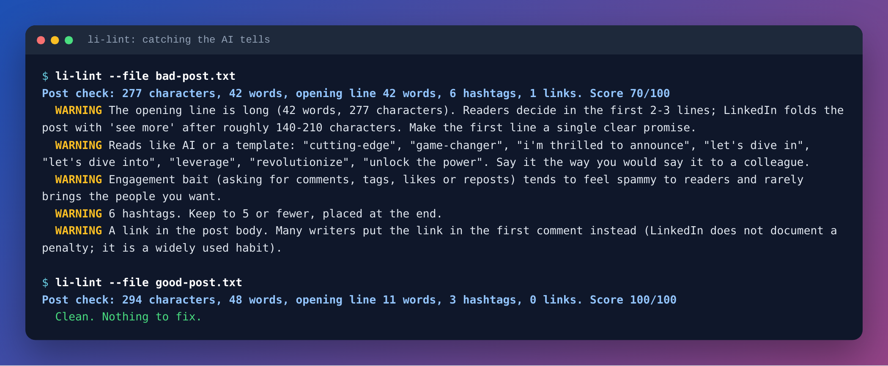</p>
<p align="center">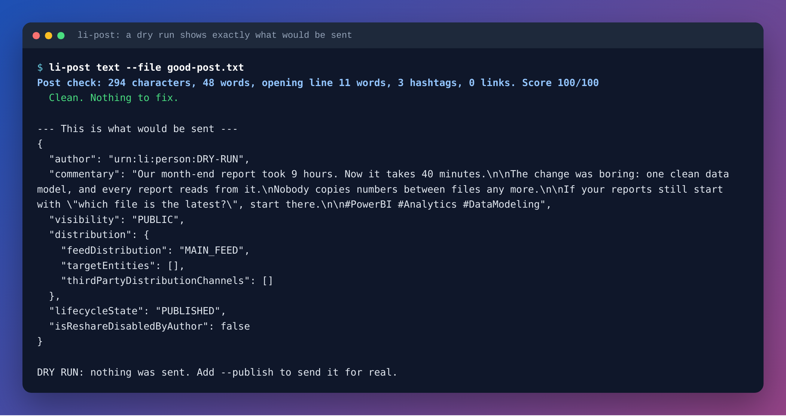</p>
<p align="center">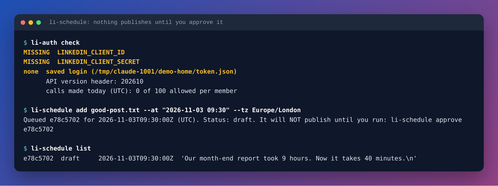</p>

## How it fits together

<p align="center">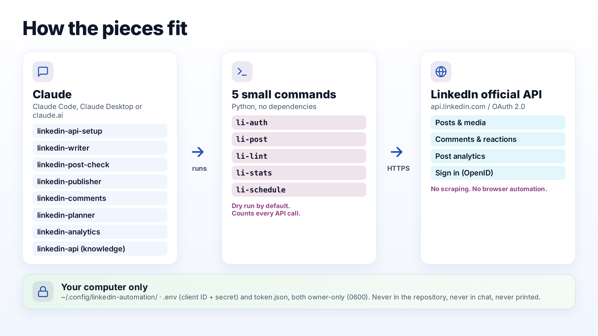</p>

The skills are instructions for Claude. The commands are small, readable Python files in [`src/linkedin_automation`](src/linkedin_automation) that do the actual work, using only the standard library.

## Safe by default

<p align="center">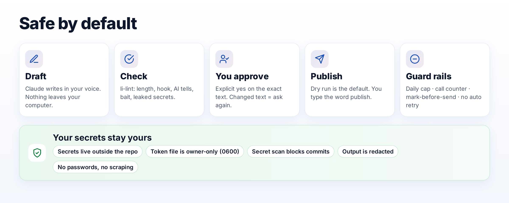</p>

- **Dry run is the default.** `li-post` shows exactly what would be sent and stops. Publishing needs `--publish` and you typing the word `publish` (or `--yes`, used only after you approved the text).
- **Human approval is built in**, including for scheduled posts: `li-schedule` never publishes an item you have not approved, marks it "sending" *before* it sends (a crash cannot double-post), never retries a failure, and has a daily cap.
- **Your secrets stay on your machine.** Client ID and secret live in `~/.config/linkedin-automation/.env`, the token in `token.json`, both owner-only (0600) and outside any repository. Output is redacted. The repo ships a **secret scanner** (`li-secrets-scan`, a pre-commit hook and a CI check) that blocks keys and tokens before they can be committed.
- **Official API only.** No scraping, no browser automation, no passwords.
- **It follows LinkedIn's rules.** LinkedIn's Developer AI Policy recommends a person stays involved before AI-written content is posted. This toolkit is designed around that, and the [`linkedin-api` skill](skills/linkedin-api/references/06-rules-and-policies.md) summarises the restricted uses, data-storage clocks and tier rules so you do not break them by accident.

## Spend LinkedIn's daily limit wisely

<p align="center">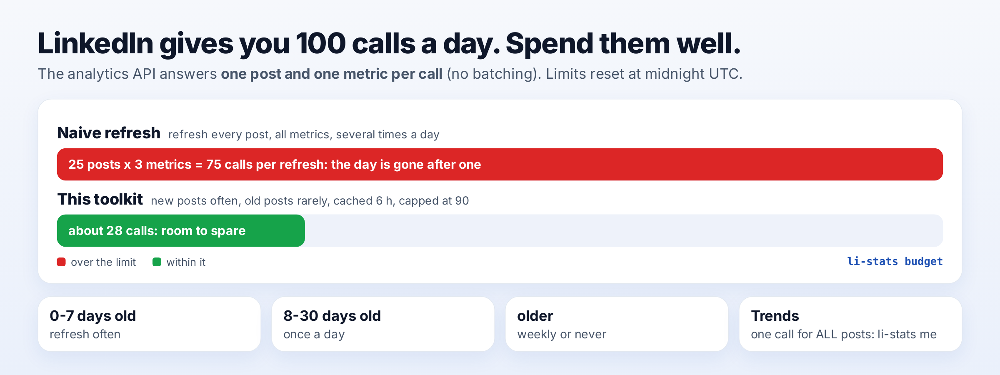</p>

LinkedIn's analytics API answers **one post and one metric per call**, and the Community Management Development tier allows **100 calls per member per day**. `li-stats` keeps a local counter, caches answers for six hours, stops at 90, and offers a one-call trend across all your posts (`li-stats me`).

## Commands at a glance

```bash
li-auth setup                         # store client ID + secret privately (hidden input)
li-auth login                         # sign in with LinkedIn (60-day token)
li-lint --file post.txt               # check a post
li-post text "Hello"                  # DRY RUN: shows exactly what would be sent
li-post image "Caption" a.png b.png --alt "describe it"
li-post document "Caption" deck.pdf --title "My deck"
li-post poll "Which topic next?" -o "DAX" -o "Data modelling" --days 3
li-post text --file post.txt --first-comment "Link: https://..." --publish
li-schedule add post.txt --at "2026-11-03 09:30" --tz Europe/London
li-schedule approve <id> ; li-schedule cron
li-stats post urn:li:share:123 ; li-stats me --metric IMPRESSION --days 30
```

## Other ways to install

- **Claude Code plugin** (above) is the easiest.
- **By hand:** `cp -r skills/* ~/.claude/skills/` (user-wide) or into `.claude/skills/` inside a project.
- **Claude Desktop / claude.ai:** zip any folder in `skills/` and upload it under Settings, in the Skills section (menu names change). Those apps can use the knowledge, writing and checking skills; to run the commands you need a terminal (Claude Code, or run the `li-*` commands yourself and paste the results).
- **Other AI tools:** the skills are plain Markdown; the commands are plain Python. Point your tool at `skills/*/SKILL.md`.

## FAQ

**Is this allowed by LinkedIn?** It uses only LinkedIn's official, public API and its documented OAuth sign-in. Read [`skills/linkedin-api/references/06-rules-and-policies.md`](skills/linkedin-api/references/06-rules-and-policies.md) for the restricted uses and the AI policy. You are responsible for how you use it.

**Do I need to pay?** No. The API products used here are free. (You need a Claude plan that supports Skills or Claude Code.)

**Will it post for me automatically?** Only what you approved, only when due, only through the queue you control. There is no "autopilot" mode on purpose.

**Can it read other people's posts or comments?** No. LinkedIn closed that permission (`r_member_social`) to everyone. The comment helper works on text you paste in.

**Does it work for a Company Page?** Posting works with `--org <id>` once your app has the Community Management API and you are a Page admin. Reading Page numbers is documented in the knowledge skill.

**Why does analytics need a second app?** LinkedIn requires the Community Management API to be the *only* product on its app.

**How long does the login last?** 60 days. `li-auth status` shows the days left.

More answers: [`docs/FAQ.md`](docs/FAQ.md) and the troubleshooting table in [`skills/linkedin-api/references/08-troubleshooting.md`](skills/linkedin-api/references/08-troubleshooting.md).

## Status and honesty

- All logic is covered by **unit tests with mocked HTTP** (run `python -m unittest discover -s tests`). They check request shapes against LinkedIn's documentation: headers, URN encoding, upload sequences, limits, approval gates and secret handling.
- Live calls to LinkedIn depend on *your* app and account. Run a dry run first, then a single `--visibility CONNECTIONS` test post and delete it (`li-post delete <urn> --publish`).
- The knowledge base is a snapshot of Microsoft Learn's LinkedIn documentation from **2026-10-29** (API version 202610). LinkedIn changes the API monthly; each guide names its source page so you can re-check.
- Not built yet: video posts, Company Page analytics commands, webhook receiver. See the [`ROADMAP.md`](ROADMAP.md) and [`CHANGELOG.md`](CHANGELOG.md).

## Credits

This project was inspired by two excellent MIT-licensed LinkedIn skill collections, which focus on writing and engagement rather than the API layer:

- [marian-kamenistak/linkedin-post-writing-skill](https://github.com/marian-kamenistak/linkedin-post-writing-skill)
- [sergebulaev/linkedin-skills](https://github.com/sergebulaev/linkedin-skills)

The writing skills here are original work, but the idea of voice calibration and an anti-AI checklist owes a lot to them. Go star them too. LinkedIn API facts come from Microsoft Learn's public LinkedIn documentation (https://learn.microsoft.com/en-us/linkedin/), summarised in our own words with a source link in every file.

The animation above was made with the [Anatomy](https://github.com/wheresryan22/anatomy) Claude skill by Ryan (MIT), which builds an idea as a working isometric machine.

*Not affiliated with, endorsed by, or sponsored by LinkedIn or Microsoft. LinkedIn is a trademark of LinkedIn Corporation.*

## Contributing and security

Pull requests welcome: see [`CONTRIBUTING.md`](CONTRIBUTING.md). Found a leak or a vulnerability? See [`SECURITY.md`](SECURITY.md) and **never post a secret in an issue**.

## License

[MIT](LICENSE) - use it, change it, sell it, keep the notice.
